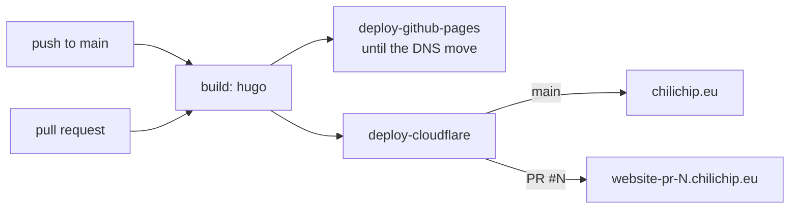

# chili-website

Source of [chilichip.eu](https://chilichip.eu): the blog, the docs and the game pages. It is a [Hugo](https://gohugo.io) site using the [Blowfish](https://blowfish.page) theme.

## Requirements

- **Hugo extended, 0.164.0 to 0.167.0.** CI builds with 0.164.0 (`.github/workflows/pages.yml`). The lower bound comes from `config/_default/module.toml` (`min = "0.164.0"`), the upper bound from the pinned Blowfish theme (`max = "0.167.0"` in `themes/blowfish/config.toml`); outside that range Hugo warns that the theme is not compatible. Get it from the [Hugo releases page](https://github.com/gohugoio/hugo/releases) (`hugo_extended_0.164.0_*`), or see [Install Hugo](https://gohugo.io/installation/). Check with `hugo version`: the output must contain `+extended`.
- **Git**, to fetch the theme submodule.
- **npm** (optional), only as a shortcut for `npm run dev`.

## Run locally

```sh
git clone https://github.com/chili-chip/chili-website.git
cd chili-website
git submodule update --init   # fetches themes/blowfish
npm run dev                   # same as: hugo server --minify -D -E -F
```

Open http://localhost:1313. The server reloads when you save a file. `-D -E -F` also shows drafts, expired and future-dated pages, so you can preview a post before it is published.

To check a production build the same way CI does:

```sh
hugo -d ./public --baseURL https://chilichip.eu
```

If the build fails with a theme error, the submodule is missing or out of date: run `git submodule update --init` again.

## How the content is organised

| Path | What lives there |
| --- | --- |
| `content/posts/<slug>/index.md` | Blog posts. Images sit next to `index.md` in the same folder (`featured.png` is the cover). Set `authors: ["<id>"]` in the front matter; ids are files in `data/authors/`. |
| `content/docs/` | Documentation: `game-sdk/` (quickstart and API), `bitsy/`, `vgc-zero/`. |
| `content/games/<game>/index.md` | One page per game. The playable web build is embedded with the `game-iframe` shortcode (below). |
| `data/authors/<id>.json` | Post authors (name, bio, links), see [Blowfish: Multiple Authors](https://blowfish.page/docs/multi-author/). |
| `layouts/shortcodes/` | Our own shortcodes: `game-iframe`, `screenshot`. |
| `archetypes/` | Templates used by `hugo new`. |
| `config/_default/` | Site config: `hugo.toml` (base URL, taxonomies, outputs), `params.toml` (theme options), `languages.en.toml` (site title, description, site-wide author), `menus.en.toml`, `markup.toml` (Markdown and syntax highlighting), `module.toml` (supported Hugo version). |
| `assets/` | Files Hugo processes: `img/` (logo, background) and `js/` (`game-iframe-focus.js`). |
| `static/` | Files copied to the site as they are: favicons and app icons. |

New post:

```sh
hugo new content posts/my-post/index.md
```

Embed a game (its web build is usually hosted on GitHub Pages of the game's repository):

```md

```

## Deploy

`.github/workflows/pages.yml` builds the site with Hugo 0.164.0 extended and deploys it. We are moving the site from GitHub Pages to Cloudflare Pages ([#69](https://github.com/chili-chip/chili-website/issues/69)). Until the DNS move, both run.

| Event | What happens | URL |
| --- | --- | --- |
| Push to `main` | Deploy to GitHub Pages (live site) | https://chilichip.eu |
| Push to `main` | Deploy to the `chili-website` Cloudflare Pages project, production branch | https://chilichip.eu after the DNS move |
| Pull request #N | Build, deploy a preview, post the link as a PR comment | https://website-pr-N.chilichip.eu |
| Pull request closed | Remove the preview hostname | - |
| Manual (`workflow_dispatch`) | Same as a push to `main` | - |

A failed build shows up as a failed **build** check on the PR. Previews are built with their own base URL, so links stay on the preview. Pull requests from forks and Dependabot get no secrets, so they only build.



### Setup (once)

1. Create a Cloudflare API token with **Account > Cloudflare Pages > Edit**, **Zone > DNS > Edit** and **Zone > Zone > Read** on `chilichip.eu`. Add it as the secret `CLOUDFLARE_API_TOKEN`, plus `CLOUDFLARE_ACCOUNT_ID` (org secrets, shared by all sites in #69). Until both exist, the Cloudflare jobs are skipped.
2. The first run creates the `chili-website` Pages project. `scripts/cloudflare-domain.sh` adds each preview hostname as a custom domain and creates its proxied CNAME.

### Move chilichip.eu to Cloudflare Pages

Do this once a preview works. The `chilichip.eu` zone is already on Cloudflare; today it proxies to GitHub Pages.

1. Open a PR and check its preview at https://website-pr-N.chilichip.eu: home page, a post, a game page, the docs.
2. Merge it, so the `main` build is on the Pages project.
3. In **DNS > Records** for `chilichip.eu`, note the current `chilichip.eu` and `www` records, for a rollback. Then open **Workers & Pages > chili-website > Custom domains** and add `chilichip.eu` (and `www.chilichip.eu` if it has a record today). Cloudflare asks to replace the apex records that point at GitHub Pages; accept.
4. Check https://chilichip.eu: the response headers no longer contain `x-github-request-id`.
5. In a follow-up PR, delete the `deploy-github-pages` job and the `upload-pages-artifact` step. Then turn off GitHub Pages in the repo settings and delete the `github-pages` environment.

To roll back, remove `chilichip.eu` from the Pages project and restore the records you noted in step 3. The `deploy-github-pages` job keeps GitHub Pages up to date until step 5.

## Updating the theme

```sh
./update.sh
```

`update.sh` moves the `themes/blowfish` submodule to the latest commit of Blowfish's `main` branch and commits only that submodule pointer. It does not push. Before you push, check the new theme's Hugo range (`[module.hugoVersion]` in `themes/blowfish/config.toml`; a Blowfish bump has already required a newer Hugo once), run the production build above, and update the Hugo version in this README, `config/_default/module.toml` and `.github/workflows/pages.yml` if it changed. Then `git push`.
