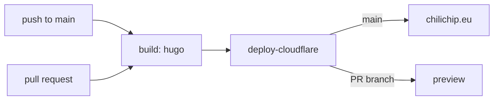

# chili-website

Source of [chilichip.eu](https://chilichip.eu): the blog, the docs and the game pages. It is a [Hugo](https://gohugo.io) site using the [Blowfish](https://blowfish.page) theme.

## Requirements

- **Hugo extended 0.167.0.** CI builds with 0.167.0 (`.github/workflows/pages.yml`). The lower bound comes from `config/_default/module.toml` (`min = "0.167.0"`), the upper bound from the pinned Blowfish theme v3.9.0 (`max = "0.167.0"` in `themes/blowfish/config.toml`); outside that range Hugo warns that the theme is not compatible. Newer Hugo releases build the site too, but wait for a Blowfish release that supports them before moving CI. Get it from the [Hugo releases page](https://github.com/gohugoio/hugo/releases) (`hugo_extended_0.167.0_*`), or see [Install Hugo](https://gohugo.io/installation/). Check with `hugo version`: the output must contain `+extended`.
- **Git**, to fetch the theme submodule.
- **npm** (optional), only as a shortcut for `npm run dev`.

## Run locally

```sh
git clone https://github.com/chili-chip/chili-website.git
cd chili-website
git submodule update --init   # fetches themes/blowfish
npm run dev                   # same as: hugo server --minify -D -E -F
```

Open http://localhost:1313. The server reloads when you save a file. `-D -E -F` also shows drafts, expired and future-dated pages, so you can preview a post before it is published.

To check a production build the same way CI does:

```sh
hugo -d ./public --baseURL https://chilichip.eu
```

If the build fails with a theme error, the submodule is missing or out of date: run `git submodule update --init` again.

## How the content is organised

| Path | What lives there |
| --- | --- |
| `content/_index.md` | The landing page copy (hero, stats, products, steps, section titles) in its front matter. The page itself is `layouts/partials/home/custom.html`, styled by `assets/css/custom.css`; its games and blog posts come from `content/games/` and `content/posts/`. |
| `content/posts/<slug>/index.md` | Blog posts. Images sit next to `index.md` in the same folder (`featured.png` is the cover). Set `authors: ["<id>"]` in the front matter; ids are files in `data/authors/`. |
| `content/docs/` | Documentation: `game-sdk/` (quickstart and API), `bitsy/`, `vgc-zero/`. |
| `content/about/index.md` | The About page: who we are and a short bio per team member. Linked from the top menu and the footer (`menus.en.toml`). Team members are cards made with the `team` and `team-member` shortcodes; add a new one there and in `data/authors/`. |
| `content/games/<game>/index.md` | One page per game. The playable web build is embedded with the `game-iframe` shortcode (below). |
| `data/authors/<id>.json` | Post authors (name, bio, links), see [Blowfish: Multiple Authors](https://blowfish.page/docs/multi-author/). |
| `layouts/shortcodes/` | Our own shortcodes: `game-iframe`, `screenshot`, `team` and `team-member` (About page cards). |
| `archetypes/` | Templates used by `hugo new`. |
| `config/_default/` | Site config: `hugo.toml` (base URL, taxonomies, outputs), `params.toml` (theme options), `languages.en.toml` (site title, description, site-wide author), `menus.en.toml`, `markup.toml` (Markdown and syntax highlighting), `module.toml` (supported Hugo version). |
| `assets/` | Files Hugo processes: `img/` (logo, `social.jpg` share image), `icons/` (extra icons for the landing page), `css/custom.css` (site styles) and `js/` (`game-iframe-focus.js`). |
| `static/` | Files copied to the site as they are: favicons and app icons. |

New post:

```sh
hugo new content posts/my-post/index.md
```

Embed a game (its web build is usually hosted on GitHub Pages of the game's repository):

```md

```

## Deploy

`.github/workflows/pages.yml` builds the site with Hugo 0.167.0 extended and deploys it to the `chili-website` Cloudflare Pages project with [Direct Upload](https://developers.cloudflare.com/pages/how-to/use-direct-upload-with-continuous-integration/) (`cloudflare/wrangler-action`). `chilichip.eu` is the project's custom domain.

| Event | What happens | URL |
| --- | --- | --- |
| Push to `main` | Deploy to production | https://chilichip.eu |
| Pull request | Build, deploy a preview of the PR branch | shown under **Deployments** on the PR |
| Manual (`workflow_dispatch`) | Same as a push to `main` | https://chilichip.eu |

A failed build shows up as a failed **build** check on the PR. Previews are built with root-relative links, so they work on the preview hostname. Pull requests from forks and Dependabot get no secrets, so they only build.



Images are served as they are (`disableImageOptimization` in `config/_default/params.toml`). Blowfish would upscale the game GIFs to 1200 px and make files over the 25 MiB Pages limit. Keep new images small before you add them.

### Setup (once, already done)

1. A Cloudflare API token with **Account > Cloudflare Pages > Edit** is the secret `CLOUDFLARE_API_TOKEN`, next to `CLOUDFLARE_ACCOUNT_ID`. Without them the Cloudflare deploy is skipped.
2. The `chili-website` Pages project has `main` as its production branch. To recreate it: `npx wrangler pages project create chili-website --production-branch=main`.
3. `chilichip.eu` is added under **Workers & Pages > chili-website > Custom domains** in the Cloudflare dashboard. Cloudflare manages its DNS record.

The site moved from GitHub Pages in [#69](https://github.com/chili-chip/chili-website/issues/69).

## Updating the theme

```sh
./update.sh
```

`update.sh` moves the `themes/blowfish` submodule to the latest commit of Blowfish's `main` branch and commits only that submodule pointer. It does not push. Before you push, check the new theme's Hugo range (`[module.hugoVersion]` in `themes/blowfish/config.toml`; a Blowfish bump has already required a newer Hugo once), run the production build above, and update the Hugo version in this README, `config/_default/module.toml` and `.github/workflows/pages.yml` if it changed. Then `git push`.
