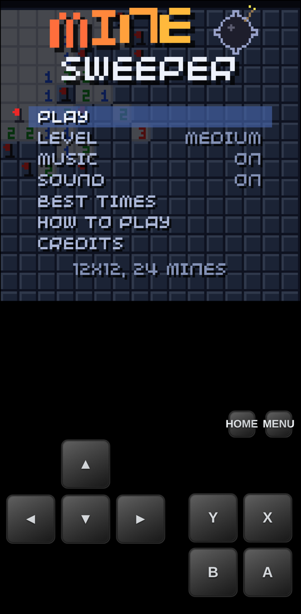
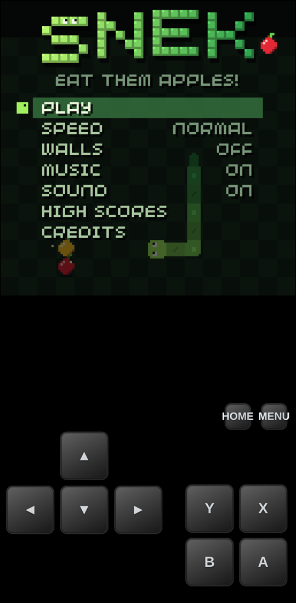
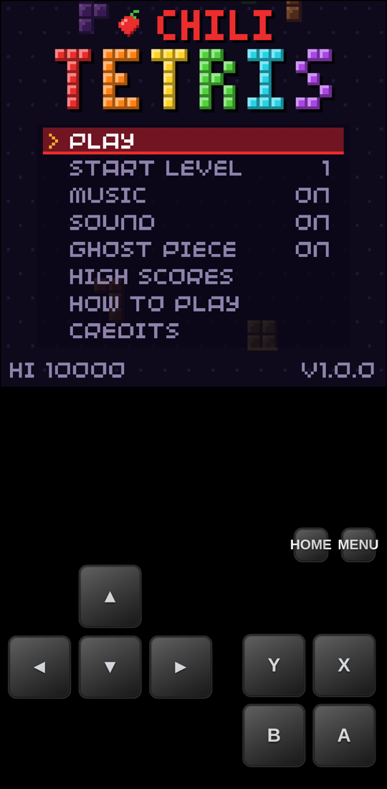
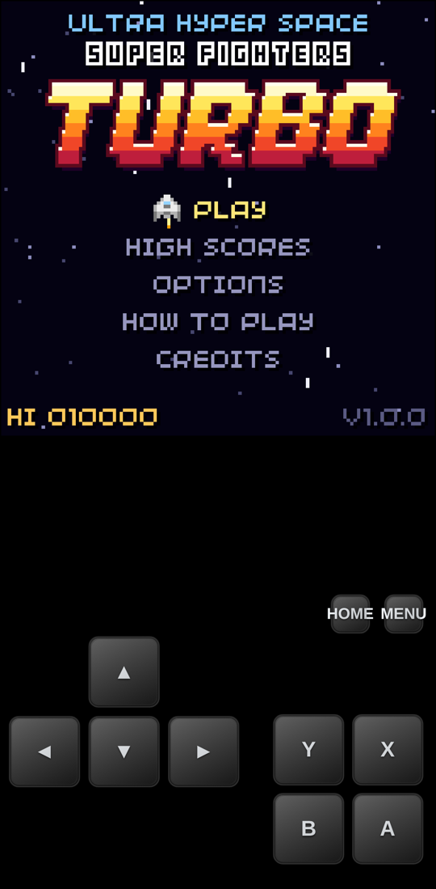

Good news: **every game made with our SDK now plays on phones and tablets**.
Open a game in your mobile browser and touch controls show up under the
screen. No app to install.

## The controls

The touch pad copies the buttons of the console, so a game works the same
everywhere.

| On the screen | What it does |
| --- | --- |
| ▲ ▼ ◄ ► | The D-pad. Move and pick menu items. |
| A, B, X, Y | The four face buttons. |
| HOME, MENU | The home and menu buttons of the console. |



## One game, six platforms

Mobile is one more piece of the puzzle. A game made with our SDK now builds
for **six platforms**:

| Platform | How you play |
| --- | --- |
| Windows | Desktop app |
| macOS | Desktop app |
| Linux | Desktop app |
| Web | Any browser, now with touch controls on phones and tablets |
| 32blit (STM32) | The 32blit handheld |
| **chilichip console** | Our own pocket console |

## Try it now

Open one of these on your phone and tap Play:


  
  
  
  


- [Minesweeper](/games/minesweeper/)
- [Snek](/games/snek/)
- [Tetris](/games/tetris/)
- [Space Fighters TURBO](/games/space-fighter/)

See [all our games](/games/) for more.


Play Minesweeper

